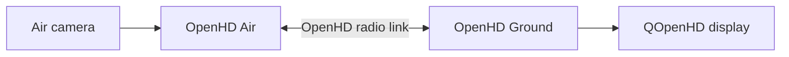

## Set up on the bench

Connect the Air camera, the supported radios and antennas, and a display or QOpenHD client on the Ground side. Power the units with the supplies specified for your hardware. Keep the units a short distance apart and remove propellers if the equipment is already mounted on a model.

## Check status and video

1. Open QOpenHD and check Ground status first. If you are using a separate QOpenHD client, verify its connection to the Ground unit.
2. Check Air status. The Air unit should appear once its telemetry reaches Ground.
3. Move something in front of the Air camera to confirm you have a live picture.
4. If a flight controller is connected, verify that its telemetry updates independently of the picture.

## If the check fails

| What you see | What to check |
| --- | --- |
| QOpenHD cannot see Ground | Check Ground power, boot media, and the client connection when using an external display device. |
| Ground is visible but Air is missing | Check Air power and boot, Air and Ground role selection, both radios and antennas, and matching binding settings. If you know Air is transmitting on another channel, use the Ground frequency scan in QOpenHD. |
| Air is visible but there is no picture | Check camera compatibility and connection, the selected camera mode, and video decoding on the Ground display. |
| Video works but flight-controller telemetry is missing | Check the Air-to-flight-controller connection and the telemetry protocol and baud rate configured on both ends. |

See [QOpenHD](./qopenhd.md) for the display controls, or [OpenHD support](/support) if you need help with a specific board and build.
