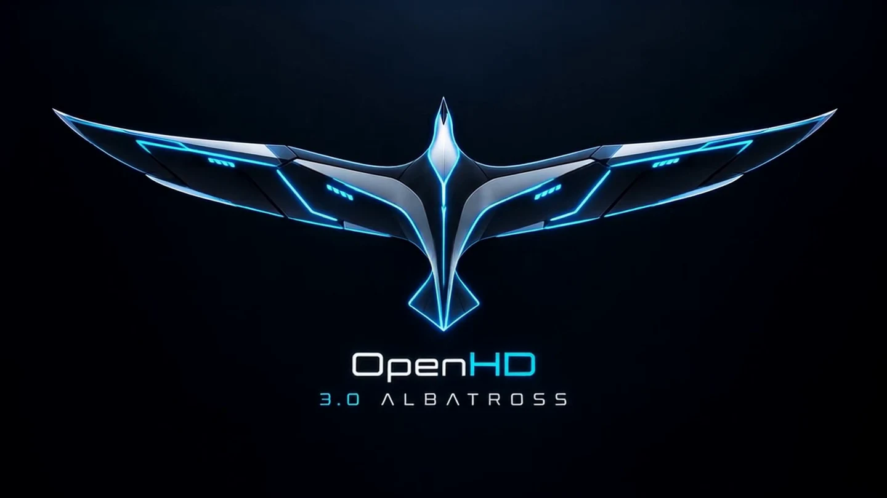

Albatross is the OpenHD 3.0 beta series. An **Air** unit sends video from the camera over the OpenHD link. A **Ground** unit receives the stream and can display video and telemetry in QOpenHD.

## Start here

1. [Install Albatross](./installation.md) on your Air and Ground units.
2. [Check your first link](./first-link.md) on the bench before installing the Air unit on a model.
3. [Get to know QOpenHD](./qopenhd.md) for link status, the on-screen display, and audio settings.

:::note Beta builds
Image availability depends on the board and its role. Check the build you plan to install for your exact hardware. Keep your working boot media and back up any recordings and settings before trying a beta.
:::
