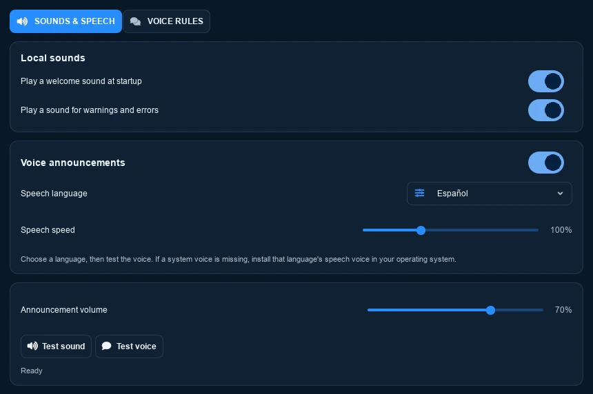

QOpenHD displays the live camera stream and overlays information from the OpenHD link and your flight controller. Available settings depend on your QOpenHD build and device.

## Video and link status

Open the on-screen sidebar using its chevron. Use the link controls to check Ground and Air status. If you're diagnosing a connection, start with the [first-link checklist](./first-link.md) before changing radio settings.

## Sounds and speech

In **Sounds & Speech**, you can configure the startup sound, warning sounds, and voice announcements independently. Select a speech language and use **Test voice** to check that your operating system has a voice for that language. **Test sound** checks the local warning sound. Use **Voice Rules** to review the events that trigger spoken announcements.

*QOpenHD development build on Windows. Controls can vary by build and platform.*
