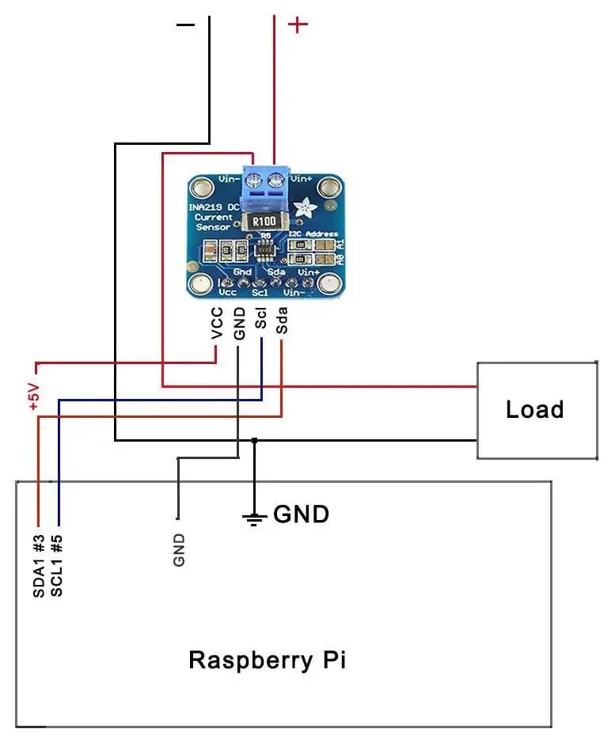
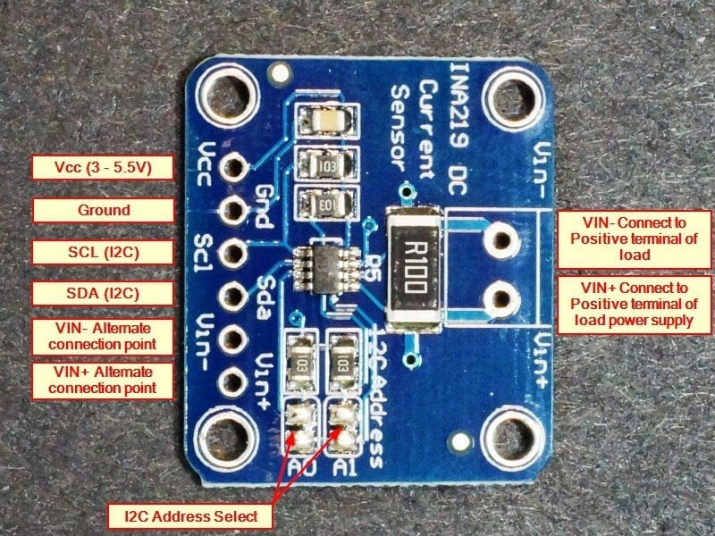
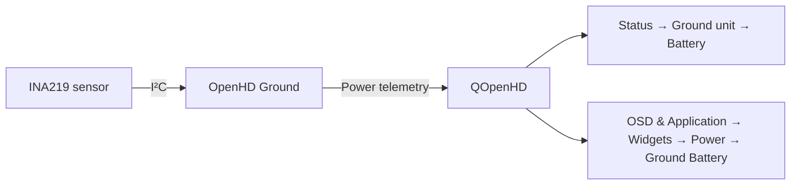

# Ground power monitoring

A supported Ground image can report supply voltage and current from an INA219 sensor. QOpenHD can display the reading in the Ground status card and on the HUD.

## Connect the INA219

With power disconnected, connect the module’s I²C lines and logic supply to the Ground board. Use the board’s pinout and the module’s voltage and current ratings. To measure load current, wire the module’s shunt in series with the positive supply feeding the load you want to measure.

## Check the reading in QOpenHD

1. Open **Status** and check **Battery** on the Ground unit. If it says **Not reported**, check the I²C wiring and whether the Ground image supports the sensor.
2. Open **OSD & Application → Widgets → Power** and enable **Ground Battery** to show the reading on the HUD.
3. Compare the displayed voltage with a meter before relying on the reading.
