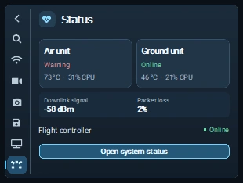
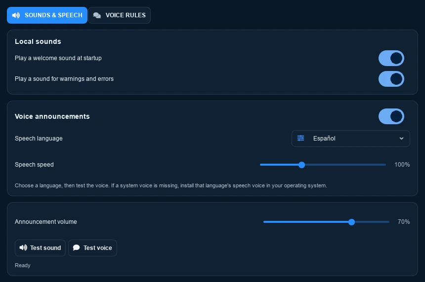

## Check and configure a link

Open **Status** to inspect the Ground unit, Air unit, and flight controller. On the HUD, open the sidebar with the chevron. **Link** shows the controls for the active transport. **Video**, **Camera**, and **Air recording** expose controls supported by the Air build. To find an Air unit with Wi-Fi broadcast, use **Find Air Unit** and choose the scan band and width.

Use **OSD & Application** for HUD widgets, styling, and maps. Edit the link or camera through the device settings, then confirm the new value is reflected in status or video. See [offline maps](./offline-maps.md) and [Backup & Restore](./qopenhd-osd-backup.md).

## Sounds and speech

Use **Sounds & Speech** to configure startup sound, warnings, and voice announcements. Select a language and use **Test voice** to check the system voice. **Voice Rules** controls which events speak.

