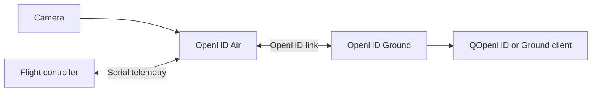
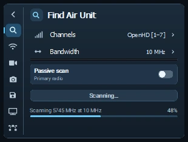

## Assemble Air and Ground

Check that the camera, radios, and Ground display are supported by your chosen images. Attach antennas before applying radio power. Use a suitable supply for each board and radio. If the equipment is mounted on a model, remove the propellers for bench testing.

## Bring up one path at a time

1. In QOpenHD, open **Status** and check that Ground is reachable. On a separate client, check the client’s connection to Ground first.
2. Check Air status. If Ground is visible and Air is missing, check both radios, matching binding settings, and the selected link settings. On Wi-Fi broadcast, open the sidebar chevron, choose **Find Air Unit**, set the band and bandwidth, and select **Start scan**. Try the width configured on Air.
3. Move something in front of the camera and confirm the picture updates. If Air is visible without video, check the camera is detected and choose a supported mode. Test one stream before adding another.
4. Check the flight controller separately. Confirm its heartbeat and live telemetry, then test any configured RC mapping and failsafe on the bench.
5. Record the working frequency, width, codec, and frame rate for later troubleshooting.

See [QOpenHD](../ground-station-software/qopenhd.md) for the sidebar and [troubleshooting](../general/troubleshooting.md) for failure isolation.

