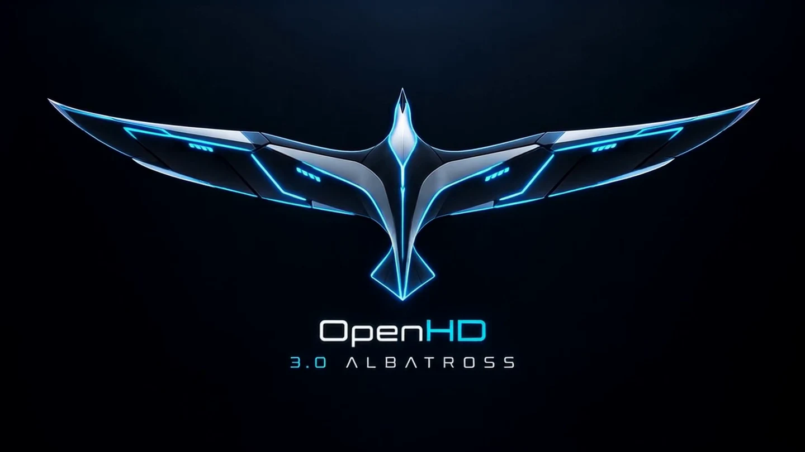

OpenHD carries live video, telemetry, and optionally RC control between an **Air** unit and a **Ground** unit. Air captures and encodes the video. Ground receives the stream and passes it to the display and any configured clients.

| If you are… | Start here |
| --- | --- |
| Moving from Evo or preparing a new unit | [Installation and migration](./installation-guide.md) |
| Selecting a board, camera, or radio | [Boards and images](./hardware/sbcs.md), [cameras](./hardware/cameras.md), and [Wi-Fi adapters](./hardware/wifi-adapters.md) |
| Checking the link for the first time | [First-time setup](./hardware/first-time-setup.md) |
| Configuring a Ground station | [QOpenHD](./ground-station-software/qopenhd.md) and [offline maps](./ground-station-software/offline-maps.md) |

### Release status

Albatross is the OpenHD 3.0 release. It is currently in beta, and the stable release is coming soon.
