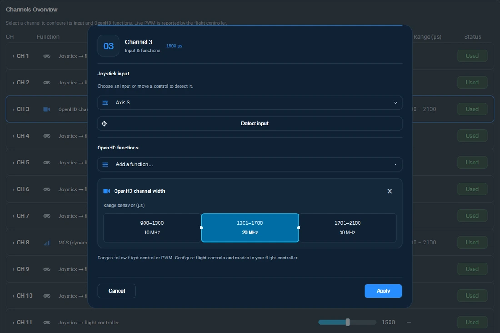

# Joystick RC control

Connect the joystick to the QOpenHD device. For a USB radio transmitter, select its joystick mode. The Air unit and flight controller need a working control path before joystick input can reach the model.

1. In QOpenHD, open **RC** and check **Channels Overview**. Move the joystick and confirm that QOpenHD sees the input.
2. Select a channel and choose an input or use **Detect input**. Review the assignment and apply it.
3. Enable joystick RC on Ground if your build requires it. Check the RC values at the flight controller and verify direction, endpoints, and failsafe with propulsion disabled.

Use the [flight controller setup guides](./telemetry-and-osd.md) to verify the serial connection. See [MCS and bandwidth via RC](./mcs-via-rc.md) for assigning link functions to RC inputs.
