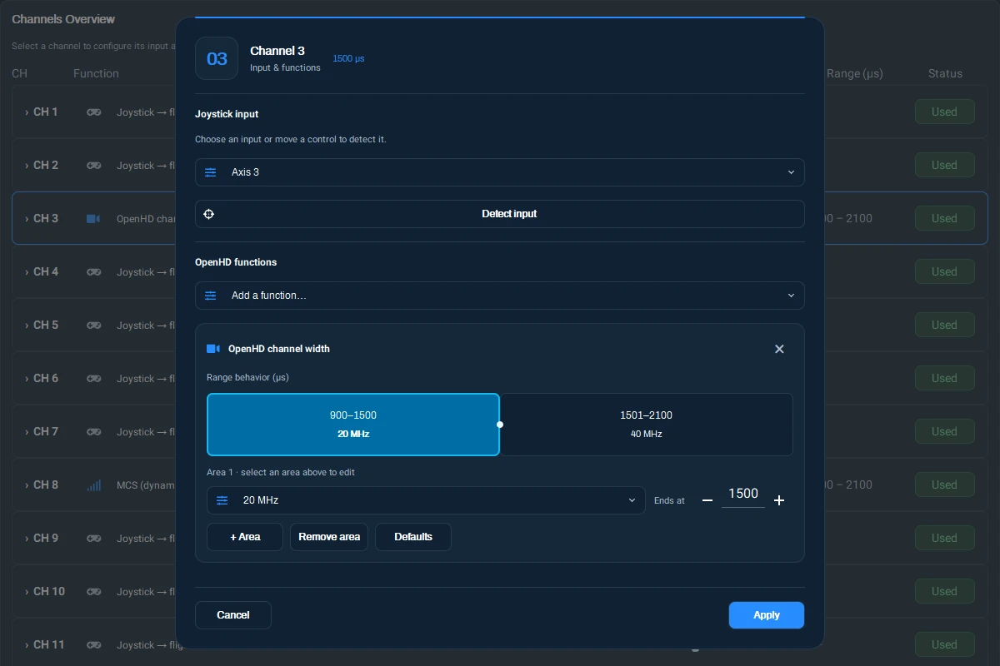

# MCS and bandwidth via RC

On supported Wi-Fi broadcast builds, OpenHD Air can map a flight-controller RC channel to a link setting. MCS changes the radio data rate. Bandwidth changes the channel width and requires both units to stay synchronized.

1. In QOpenHD, open the RC channel view and confirm that the channel reports live PWM from the flight controller.
2. Assign an unused input to **MCS** or **OpenHD channel width**, as exposed by your Air build.
3. Open **PWM ranges** for the assignment. Move the transmitter switch through its positions and match the ranges to the observed values. Assign only modes supported by the radio and link.
4. With the model on the bench, move through every position and verify the actual MCS or width and that video recovers after a width change.

The current Air firmware exposes `RC_MCS_RANGES` and `RC_BW_RANGES` where supported. A width option can be absent if the radio or firmware does not support it. Keep your original link settings written down and use **Find Air Unit** if Ground needs to rescan.

